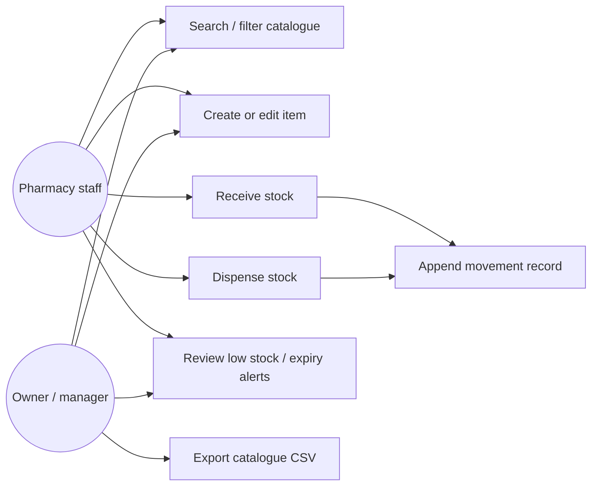
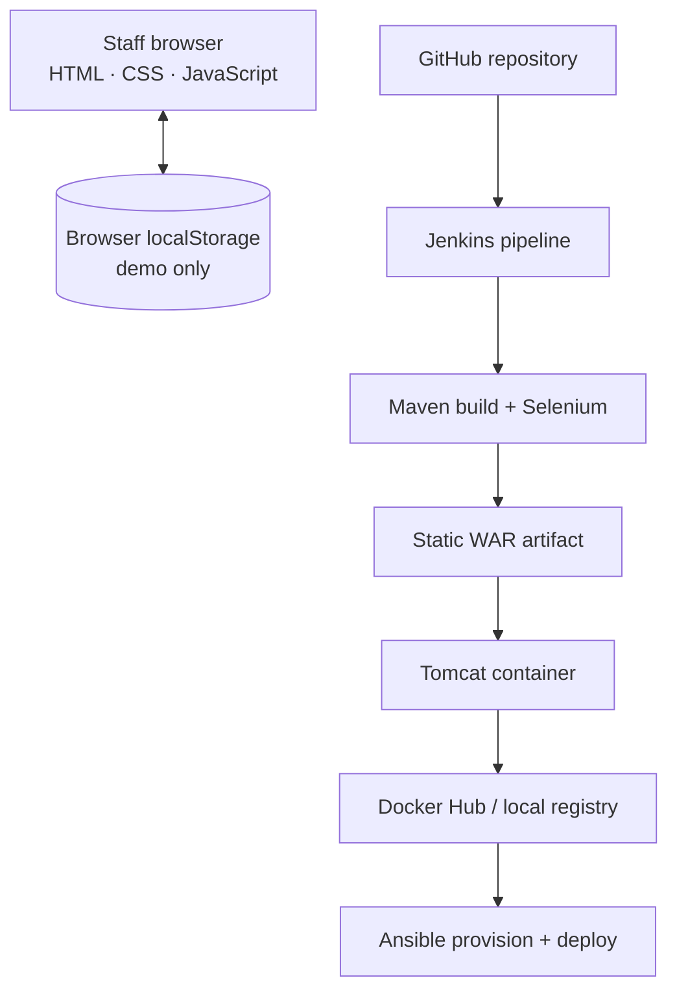

# Task 3 — SRS, architecture and interfaces

## SRS summary

**Purpose:** help pharmacy staff maintain an accurate local stock catalogue and quickly locate exceptions.

**Functional requirements:** FR-01 catalogue item fields (name, SKU, category, quantity, reorder point, supplier, expiry); FR-02 add/edit with required-field, integer, nonnegative, and unique-SKU validation; FR-03 receive/dispense stock movement; FR-04 prevent dispensing above available quantity; FR-05 append a movement audit record; FR-06 search by name/SKU/category/supplier; FR-07 filter status; FR-08 flag quantity zero, quantity at/below reorder point, and expiry in 90 days; FR-09 export catalogue to CSV.

**Nonfunctional requirements:** responsive 360px+ layout; keyboard-operable native controls; WCAG 2.2 AA intent; local HTTP response under 2s for sample records; reproducible Maven WAR package; container port 8080; `/health` response from deployed static container. Browser local storage is a demo persistence boundary only.

## Use cases

## Architecture

**Stack decision:** plain HTML/CSS/JavaScript keeps the teaching MVP small and runnable without a database; Maven packages the static site as a WAR; Tomcat serves the WAR; Selenium WebDriver/JUnit 5 covers browser journeys; Docker provides a reproducible Tomcat runtime; Ansible configures a Linux target. There is no API server in this MVP. A production evolution would replace localStorage with a secured service and relational database, then define access control and audit retention.

## Data model

`InventoryItem(id, name, pack, sku, category, qty, reorder, supplier, expiry, icon)` where `qty >= 0`, `reorder >= 0`, and `sku` is unique. `StockTransaction(id, itemName, sku, type, delta, qtyAfter, at)` is appended for each receive/dispense action. Status is derived as `out` if qty is zero, otherwise `low` if qty <= reorder, otherwise `expiring` if expiry is within 90 days, otherwise `healthy`.

## API / UI contract

No network API is exposed. The application operations are implemented by `app/app.js`:

| Operation | Input | Result |
|---|---|---|
| `listItems(query, status)` | optional text and status | filtered catalogue rows and counts |
| `saveItem(item)` | validated catalogue fields | insert/update local item |
| `recordMovement(sku, type, quantity)` | receive/dispense and positive integer | stock update + append transaction; reject negative result |
| `exportItems()` | none | downloadable CSV |
| `health` | HTTP GET `/health` when containerized | static JSON health response |

## Local development

Prerequisites: Java 17+, Maven 3.9+, Python 3, Docker for container work, and Chrome/Chromium for Selenium. Run `python3 -m http.server 8080 --directory app`, then open `http://localhost:8080`. Build the distributable using `mvn clean package`. Browser data remains on the device/profile that created it.
