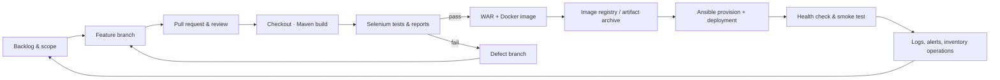

# 15-task course plan

| # | Task / backlog outcome | Acceptance / evidence |
|---|---|---|
| 01 | Define problem, users, constraints, measurable outcomes; freeze MVP | Scope document approved; 15 tasks named; constraints visible |
| 02 | Plan backlog, sprint board, DoD, lifecycle | Stories and acceptance criteria are traceable to the MVP |
| 03 | Define SRS, use cases, architecture, model, endpoints, local setup | Architecture and contracts match implementation; local app runs |
| 04 | Initialize GitHub-ready repository | README, ignore, issue templates, branch policy, initial commit |
| 05 | Deliver catalogue lookup as feature branch | Search, filter, tests, reviewed PR checklist, merge record |
| 06 | Complete catalogue edits, stock movement and alerts | Validation and transaction ledger work; conflict/release exercise documented |
| 07 | Configure Maven CI and archive WAR | Jenkins job builds and archives a versioned artifact |
| 08 | Pipeline as code and Tomcat deployment | Parameterized Jenkinsfile deploys WAR and checks application URL |
| 09 | Selenium critical journey suite | Four browser journeys with assertions and failure screenshots |
| 10 | Gate deployment on browser tests | Test report publishes; injected failure blocks deploy; fix and rerun |
| 11 | Container image and lifecycle | Build/run/log/stop/restart/remove commands documented |
| 12 | Jenkins Docker continuous deployment | Tests gate versioned build/publish/deploy; registry is configurable |
| 13 | Ansible configuration management | Inventory/playbook configures packages, directories, service, ports |
| 14 | Provision, idempotency, health check and rollback | Second playbook run has no changes; health and rollback evidence captured |
| 15 | Release readiness and evidence handoff | Final release checklist, immutable tag, evidence index, recovery notes |

## Backlog user stories

- **US-01 Catalogue lookup (P0):** As counter staff, I can search by name, SKU, category, or supplier so I can confirm stock quickly. *Given* catalogue entries exist, *when* I type a query, *then* matching entries appear and a clear action resets the query.
- **US-02 Filter stock status (P0):** As staff, I can filter in-stock, low-stock, out-of-stock, or expiring products so I can focus on relevant work. *Then* result count and rows match the selected status.
- **US-03 Create/update product (P0):** As a manager, I can add or edit catalogue details and reorder point. *Then* required fields validate, SKU is unique, and the changed item persists locally.
- **US-04 Receive stock (P0):** As staff, I can add received units. *Then* quantity increases and an audit row records the delta and result.
- **US-05 Dispense stock (P0):** As staff, I can record dispensed units. *Then* quantity decreases and a movement greater than on-hand is rejected.
- **US-06 Review exceptions (P0):** As a manager, I can see low, zero, and expiring stock. *Then* status labels and alert totals update after every movement.
- **US-07 Export catalogue (P1):** As a manager, I can download CSV to prepare an external order review.

## Sprint / Kanban board

Two one-week sprints; one learner/developer with instructor review. WIP limit: 2 in progress. Move a story only when its acceptance checks are met.

| Backlog | Sprint 1 / In progress | Review | Done |
|---|---|---|---|
| CSV polish; auth/roles (out of MVP) | Tasks 01–04, US-01, US-02 | Task 05 PR | Local app, scope and architecture |
| Production database (out of MVP) | US-03, US-04, US-05, US-06 | Task 06 release review |  |
|  | Sprint 2: Tasks 07–15 | Instructor checks CI/CD evidence |  |

## Definition of Done

- Story acceptance criteria are met and linked from the task board.
- Change is committed on a named branch with a meaningful message and reviewed before integration.
- Maven package and automated browser tests pass; reports/artifacts are retained.
- No secrets or real pharmacy/patient records are committed.
- Deployment configuration is parameterized and health-checked.
- Screenshot evidence is saved under the matching `screenshots/task-NN/` folder.
- Operational and rollback notes are updated for release-facing changes.

## DevOps lifecycle

